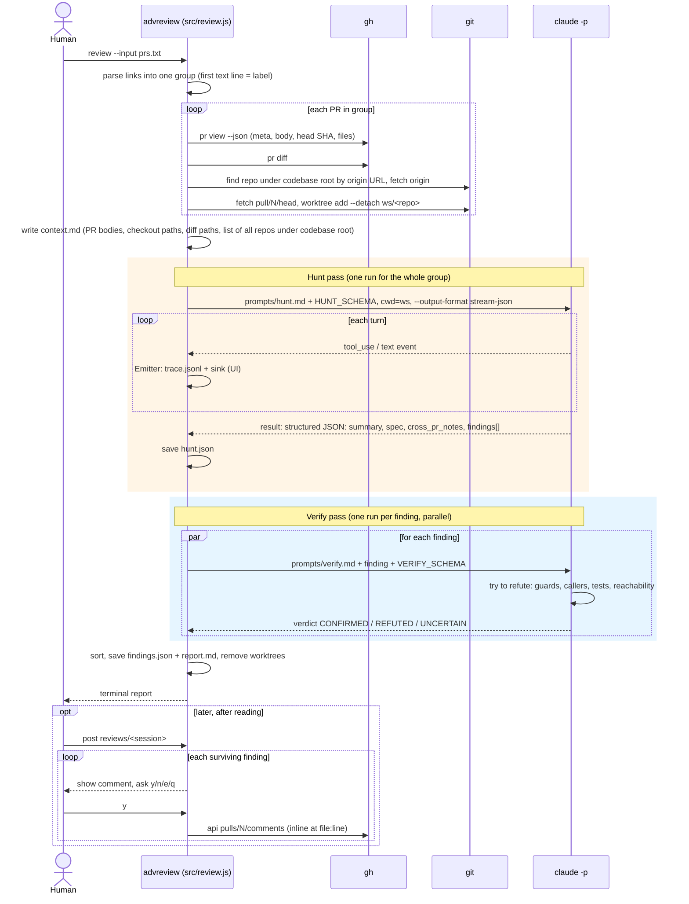
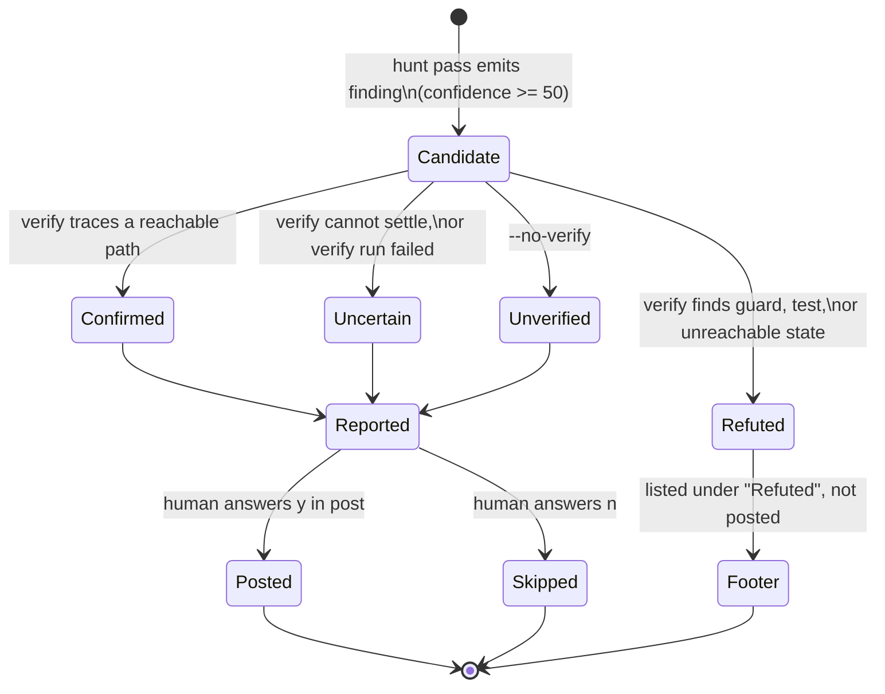
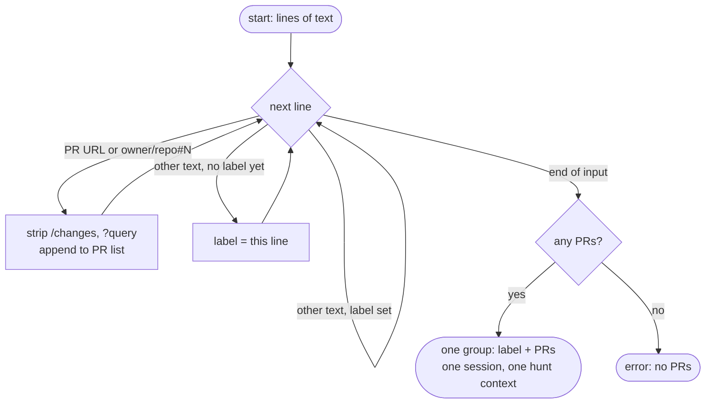
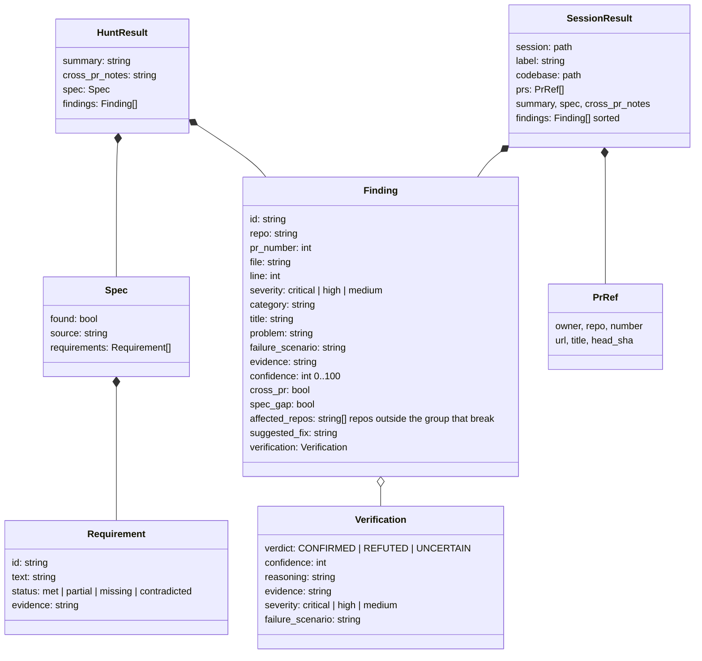
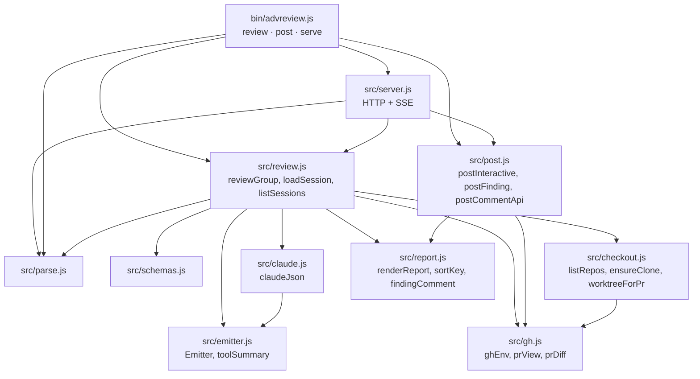
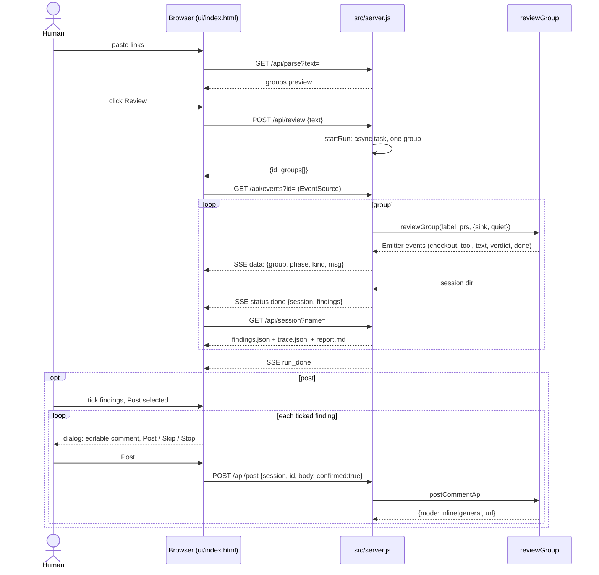

# advreview architecture

A local tool that reviews a group of GitHub pull requests adversarially. It
uses the `claude` CLI already logged in on the machine, so there is no API key
to manage. It never posts to GitHub on its own.

## 1. Components

Component diagram. Boxes are processes or stores; arrows are calls or file
reads.

```mermaid
flowchart LR
    U([Reviewer\nhuman]) -->|PR URLs, pasted text| CLI
    U -->|browser| WEB

    subgraph src/server.js + ui/index.html
        WEB[Web UI\nSSE trace, report, post dialog]
    end
    WEB -->|reviewGroup(sink)| CO
    WEB -->|postCommentApi| PO

    subgraph src/*.js (core)
        CLI[CLI\nreview / post]
        EM[Emitter\ntrace.jsonl + sink]
        GP[Group parser]
        CO[Checkout manager]
        HP[Hunt pass]
        VP[Verify pass\nN parallel]
        RP[Report renderer]
        PO[Poster\ninteractive y/n/e/q]
        CLI --> GP --> CO --> HP --> VP --> RP
        CLI --> PO
    end

    subgraph External tools
        GH[gh CLI]
        GIT[git]
        CL[claude -p\nheadless, --json-schema]
    end

    subgraph Stores
        LR[(codebase root\n~/workspace/git/*\nall platform repos)]
        CC[(~/.cache/advreview/repos\nfallback clones)]
        SS[(reviews/<timestamp>/\nsession dir)]
        PR[(prompts/*.md)]
    end

    CO --> GH
    CO --> GIT
    GIT --> LR
    GIT --> CC
    CO -->|context.md, *.diff, ws/ worktrees| SS
    HP --> CL
    VP --> CL
    HP -.reads.-> PR
    VP -.reads.-> PR
    CL -->|Read / Grep / Glob / git log,diff,blame| SS
    CL -->|Grep consumers in\ndependent repos| LR
    HP -->|hunt.json| SS
    HP --> EM
    VP --> EM
    EM -->|trace.jsonl| SS
    EM -.events.-> WEB
    RP -->|findings.json, report.md| SS
    RP -->|terminal report| U
    PO -->|reads findings.json| SS
    PO -->|POST review comment| GH
    GH --> GitHub[(GitHub)]
```

Key boundaries:

- `claude -p` sees the session dir, the PR worktrees, and the whole codebase
  root (`--add-dir`). PR repos are read from their worktree; every other repo
  under the root is a dependent project at the developer's current checkout,
  searched for consumers of what the PRs change. Its tools are
  always read-only (`Read`, `Grep`, `Glob`, `Agent`, and
  `git log/diff/show/blame`). It never runs tests or builds.
- `claude -p` runs with `--setting-sources project`, so the reviewer's own
  user-level hooks and prompts do not leak into the review.
- The poster is a separate subcommand. It reads a saved session and asks
  before every comment.
- The web server never runs its own review logic. It calls `reviewGroup`
  with a sink and `postCommentApi`, the same functions the CLI uses.

## 2. Review flow

Sequence diagram for one group of PRs.



## 3. Finding lifecycle

State diagram. A finding is born in the hunt pass and ends either in the
report or in the "refuted" footer.



Severity can change on `Confirmed`: the verifier may correct the hunt pass's
severity and rewrite the failure scenario with a more precise one.

## 4. Input parsing

Activity diagram for turning pasted text into the one review group. There is
no way to split a paste: dependent PRs must be reviewed in one context.



The session directory is named `reviews/<timestamp>-<label-slug>/`, or
`reviews/<timestamp>/` without a label.

## 5. Data shapes

Class diagram of the JSON that flows between the passes and into the report.
These mirror `HUNT_SCHEMA` and `VERIFY_SCHEMA` in `src/schemas.js`, which
`claude -p` enforces through `--json-schema`.



`head_sha` on `PrRef` is what the poster uses as `commit_id`, so comments
land on the exact commit that was reviewed.

## 6. Modules



Rules: `src/claude.js` is the only module that spawns `claude`; `src/gh.js`
is the only module that runs `gh`; `src/post.js` is the only module that
writes to GitHub.

## 7. Session directory

What one run leaves on disk.

```
reviews/20261015-181610-screen-management/
├── context.md                      PR bodies, checkout paths, diff paths, label, repos under codebase root
├── <owner>__<repo>__pr<N>.diff     one per PR, read by the hunt pass
├── hunt.json                       raw hunt output (survives a failed verify)
├── trace.jsonl                     one event per line: ts, phase, kind, msg (tool calls, notes, verdicts)
├── findings.json                   hunt + verification, sorted; input to `post`
├── report.md                       the terminal report, plain text
└── ws/                             worktrees; removed unless --keep-workspace
```

## 8. Web UI

`src/server.js` is a Node `http` server on `localhost:8765`. It serves
`ui/index.html` and these endpoints. Reviews run as an async task in the same
process; the trace reaches the browser over Server-Sent Events.



Endpoints:

| Method | Path | Purpose |
|---|---|---|
| GET | `/` | the page |
| GET | `/api/config?codebase=` | default codebase root, or whether a given one exists and how many repos it holds |
| GET | `/api/parse?text=` | preview of the group parsed from pasted text |
| POST | `/api/review` | start a run; body `{text, codebase}` |
| GET | `/api/run?id=` | run status |
| GET | `/api/events?id=` | SSE stream of trace events; ends with `run_done` |
| GET | `/api/sessions` | past sessions on disk, newest first |
| GET | `/api/session?name=` | one session: findings, trace, report.md |
| POST | `/api/post` | post one finding; refused without `confirmed: true` |

Trace event kinds: `info`, `ok`, `warn`, `error`, `tool`, `text`, `verdict`,
`done`, plus server-only `status` and `run_done`. Phases: `checkout`, `hunt`,
`verify`, `done`.

## 9. Why these choices

- **Full checkout, not diff only.** Most regressions live in callers the diff
  does not touch. The hunt prompt tells the model to grep every changed symbol.
- **One hunt run for everything pasted.** Cross-repo contracts (API shape,
  event payload, deploy order) are only visible when all PRs are in one
  context. The parser cannot split a paste, so a dependent set is never
  reviewed piecemeal by accident.
- **Separate verify run per finding.** A single-pass reviewer overclaims.
  A fresh run told to refute the finding drops the weak ones and sharpens the
  rest. Failures in this pass degrade to `UNCERTAIN` instead of losing the hunt.
- **Structured output via `--json-schema`.** The report and the poster read
  typed JSON, not prose, so they never parse model text.
- **One codebase root for everything.** The parent directory of all platform
  repos (default `~/workspace/git`, configurable from CLI and UI) serves two
  purposes: PR repos are found there by origin URL, so no second clone; and
  every other repo there is opened to the reviewer as a dependent project. A
  PR that touches one repo can still break a consumer in another, and that
  consumer has no PR to review. Worktrees keep the reviewer's own branch and
  working tree untouched.
- **Read-only reviewer.** No shell beyond read-only git. Reviewing never
  executes PR code on the reviewer's machine. Spec comes from a spec PR in the
  group, not a side channel.
- **Node package, zero dependencies.** Runs with the Node already on a
  developer's machine. Nothing to install behind a corporate proxy, no lock
  file to audit, no build step.
- **Human in the loop for posting.** Findings reach GitHub only after a
  person reads the report and answers `y` per comment (CLI) or clicks Post in
  the per-finding dialog (UI). The server refuses a post without the
  `confirmed` flag.
- **Node built-ins only, single HTML file.** No npm dependencies, no build,
  no framework updates. The UI is a thin view over the same functions the
  CLI calls.
