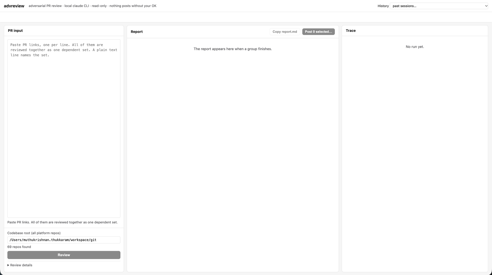

# advreview

Adversarial review of a set of dependent GitHub pull requests, driven by the
`claude` CLI already logged in on your machine. It assumes the PRs are broken
and looks for proof: regressions, contract breaks between repos, spec gaps,
and consumers in other projects that the PRs never touched.



- **No API key.** Uses your `claude` login.
- **Read-only.** The reviewer reads code and git history. It never runs tests,
  builds, or any code from the PRs.
- **Human posts.** Nothing reaches GitHub until you confirm each comment.

## Requirements

| Tool | Why | Check |
|---|---|---|
| Node.js 18.17+ | runs the tool; no npm dependencies | `node --version` |
| `claude` CLI, logged in | the reviewer | `claude --version` |
| `gh` CLI, logged in | PR metadata, diffs, clones, posting | `gh auth status` |
| `git` 2.20+ | worktrees at PR heads | `git --version` |

If you use more than one GitHub account, log them all in with `gh auth login`.
The tool picks, per repository owner, the first account that can read the
repo. It never switches your active `gh` account. Force one with
`ADVREVIEW_GH_USER=<login>`.

## Start the UI

```bash
git clone <this repo> advreview
cd advreview
npm start
```

Open <http://localhost:8765>. There is no install step and nothing to build.

To use another port, or another codebase root:

```bash
node bin/advreview.js serve 9000
ADVREVIEW_CODEBASE=/path/to/repos npm start
```

| variable | default | meaning |
|---|---|---|
| `ADVREVIEW_CODEBASE` | `~/workspace/git` | default codebase root shown in the UI |
| `ADVREVIEW_OUT` | `./reviews` | where sessions are written |
| `ADVREVIEW_GH_USER` | auto | force one `gh` account for every repo |

## Using the UI

The page has three panes: **PR input** on the left, **Report** in the middle,
**Trace** on the right.

1. **Codebase root.** The parent directory of every platform repo. The field
   validates live and shows how many repos it holds. The browser remembers
   it.
2. **Paste PR links**, one per line. See [PRs](#prs) below for what is
   accepted and how the set is treated.
3. **Review.** The Trace pane streams the run: checkouts, every file read,
   grep, git command, the reviewer's notes, and each verify verdict. Cost and
   tool-call count sit in the pane header. **Review details** under the button
   shows what the reviewer was given.
4. **Report** fills in when the run ends: summary, cross-PR contract check,
   spec compliance table, findings ranked by severity, refuted findings in a
   footer. **Copy report.md** copies it as plain text.
5. **Post.** Tick findings, click **Post selected**. Each one opens in a
   dialog with the editable comment and its own Post / Skip / Stop. Posted
   findings show a link to the GitHub comment.
6. **History** (top right) reopens any past session with its trace and
   report.

A run keeps going if you close the page. Reopen it from History when done.

## PRs

### Accepted link forms

| form | example |
|---|---|
| full URL | `https://github.com/owner/repo/pull/123` |
| URL with a tail | `https://github.com/owner/repo/pull/123/files`, `.../changes`, or a query string |
| short | `owner/repo#123` |
| path | `owner/repo/pull/123` |

One PR per line. Blank lines are ignored. A line that is not a PR link becomes
the label of the set, which also names the session directory.

### One set, one context

Every PR you paste is reviewed together as one dependent set, because
dependent PRs cannot be judged apart. The reviewer:

- reads every diff and the full checkout of every PR's repo at the PR head;
- checks the contracts between the PRs and what breaks if they deploy in any
  order;
- searches every other repo under the codebase root for consumers of what the
  PRs change, and flags those with `AFFECTS <repo>`;
- extracts requirements from PR bodies or a spec file in the diffs and checks
  the PRs against them, flagging gaps with `SPEC-GAP`.

Include the spec PR (for example the OpenSpec change) in the set so
requirements get validated. Spec links to Jira or Confluence in a PR body are
not fetched.

### What happens to each PR

Each PR's repo is found under the codebase root by origin URL and fetched.
Repos not found there are cloned once into `~/.cache/advreview`. A detached
git worktree is created at the PR head under `reviews/<session>/ws/`. Your own
branches and working trees are never touched. Worktrees are removed when the
run ends.

Repos under the codebase root that have no PR in the set are read at whatever
branch you have checked out locally. Pull them to master before an important
review.

### Posting comments

A posted finding becomes an inline review comment at the finding's file and
line, on the exact commit that was reviewed. If GitHub rejects the position,
a general PR comment naming the file and line is posted instead. Nothing is
posted until you click Post in the per-finding dialog.

## Expectations

- A set of 6 to 7 PRs, about 15,000 changed lines, takes 20 to 30 minutes.
  Hunt pass roughly $10 to $15 shown, verify passes $1 to $4 each.
- A single small PR takes 3 to 5 minutes.

## Troubleshooting

| Symptom | Cause and fix |
|---|---|
| `no logged-in gh account can see owner/repo` | None of your `gh` logins can read it. `gh auth login` with the right account, or set `ADVREVIEW_GH_USER`. |
| Review button stays disabled | No PR links recognised, or the codebase root does not exist. The field shows the repo count when the path is right. |
| `claude hunt failed` with usage-limit text | Your Claude quota ran out mid-run. Wait for the reset and rerun. |
| Verify pass shows `UNCERTAIN · verify pass failed` | That one verify run failed (often quota). The finding is kept unverified. |
| Trace shows paths under `reviews/.../ws/` | Normal: the reviewer reads the PR worktree, not your checkout. |

## Further reading

- `ARCHITECTURE.md`: components, review flow, finding lifecycle, data shapes,
  session directory, web UI endpoints.
- `SPEC.md`: numbered requirements with acceptance criteria and verification.
- `CLAUDE.md`: rules for changing this repo, including the doc-sync table.
- `bin/advreview.js --help`: the `review` and `post` CLI subcommands and
  their flags.
